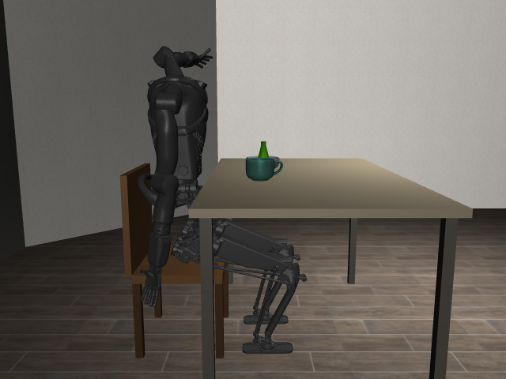

# robot-learning: seated Kangaroo + LIBERO environments

A Docker image (ROS 2 Humble, Ubuntu 22.04, Python 3.10) for robot-learning work with PAL Robotics'
**Kangaroo** humanoid. It has two Python venvs and one task-free scene: Kangaroo seated on a chair at a table with a cup, a water
bottle and a bowl, for seated upper-limb rehab work. There is no task or suite to pick; it is just a working simulation.
Terms are defined in [CONTEXT.md](CONTEXT.md).



(Snapshot; `pytest -v tests` regenerates it in the git-ignored `out/`.)

## Layout

```
setup.sh              clones pinned pal_mjlab and LIBERO, downloads object assets
Dockerfile            ros:humble-ros-base + two venvs: /opt/venvs/mjlab (default) and /opt/venvs/libero
kangaroo_seated/      the scene: scene.py (MjSpec), mjlab_cfg.py (mjlab SceneCfg), seated_setup.json
view.py               live viewer or headless video
tests/                pytest suite
pal_mjlab/ LIBERO/ assets/   fetched by setup.sh (git-ignored)
```

| Venv | Python | Contents |
|---|---|---|
| `/opt/venvs/mjlab` (default `python`) | 3.10 | pal_mjlab, mjlab 1.6.0, MuJoCo + MuJoCo Warp 3.11 (PAL's lockfile); `rclpy` importable |
| `/opt/venvs/libero` | 3.10 | original LIBERO with its own pinned requirements, MuJoCo 3.2.3 |

ROS 2 Humble is sourced in every container shell (`ros2`, `rclpy`); it is not wired to the
simulator yet. The venvs stay separate because LIBERO pins numpy 1.22 and mjlab needs numpy 2:
LIBERO feeds the scene as MuJoCo files instead ([ADR 0001](docs/adr/0001-one-simulator-libero-as-scene-content.md)).

## Build and run

Host prerequisites for `setup.sh`: git, curl, python3, Docker (plus the NVIDIA Container Toolkit for `--gpus`).

```bash
./setup.sh                                  # clone pal_mjlab @52f5d6ed5d, LIBERO @8f1084e313, download assets
docker build -t robot-learning .            # add --build-arg TORCH_EXTRA=cpu for a CPU-only torch
docker run --rm -it --gpus all -v "$PWD:/workspace" robot-learning     # bash in /workspace
pytest -v tests                             # inside the container
```

No NVIDIA GPU: drop `--gpus all` (the Warp test then skips); if EGL is unavailable add `-e MUJOCO_GL=osmesa -e PYOPENGL_PLATFORM=osmesa`.
Files the container writes into the mount (`out/`, `__pycache__`) are root-owned on the host.

Or run the tests directly: `docker run --rm --gpus all -v "$PWD:/workspace" robot-learning pytest -v tests`.

The first MuJoCo Warp run compiles kernels (about 4.5 minutes). Warp caches them in
`/root/.cache/warp`, so mount it to keep them across runs: add `-v "$HOME/.cache/warp:/root/.cache/warp"` to `docker run`.

## Viewing

Live window (Linux desktop; mouse to orbit/zoom):

```bash
xhost +local:docker
docker run --rm -it --gpus all -e DISPLAY=$DISPLAY -e MUJOCO_GL=glfw -e PYOPENGL_PLATFORM= \
  -v /tmp/.X11-unix:/tmp/.X11-unix -v "$PWD:/workspace" robot-learning python view.py
```

Video, no screen needed:

```bash
docker run --rm --gpus all -v "$PWD:/workspace" robot-learning python view.py --video out/kangaroo.mp4 --seconds 5
```

## Using the scene

```python
from kangaroo_seated import make_model, make_scene_cfg

m, d = make_model()            # plain MuJoCo: seated Kangaroo, chair, table, cup, bottle, bowl
cfg = make_scene_cfg()         # mjlab SceneCfg (num_envs=1 by default) for mjlab tasks
```

- In plain MuJoCo the model has no actuators (pal_mjlab's XML has none): arms are passive; apply torques via `d.qfrc_applied`. Body names are `robot/...`, `cup`, `bottle`, `bowl`, `chair`, `table`.
- In mjlab, arms use pal_mjlab's position actuators; legs and trunk are held at the seated pose by equality locks (pal_mjlab's gains alone sag 0.0745 rad). Body names are entity-prefixed (`cup/cup`). Use the standard `mdp.reset_scene_to_default` reset event so the robot starts seated; a bare `sim.reset()` returns to qpos0.
- The hands are rigid: pal_mjlab comments out every finger/palm joint in `kangaroo_hands.xml`, so objects can be pushed or scooped but not grasped with fingers.
- The seated pose lies within Kangaroo's real joint limits (checked by the tests).
- The original LIBERO runs separately: `docker run ... robot-learning /opt/venvs/libero/bin/python your_script.py`.

## Sources

- Seated setup (base pose, joint angles, table, chair, object layout): `seated_setup_for_libero`, `seated_setup.json` version 2026-10-19.
- Kangaroo: [pal_mjlab](https://github.com/pal-robotics/pal_mjlab). LIBERO: [Lifelong-Robot-Learning/LIBERO](https://github.com/Lifelong-Robot-Learning/LIBERO).
- Objects: cup and bowl from Google Scanned Objects via [mujoco_scanned_objects](https://github.com/kevinzakka/mujoco_scanned_objects); bottle from robosuite v1.5.2. See [NOTICE](NOTICE).
